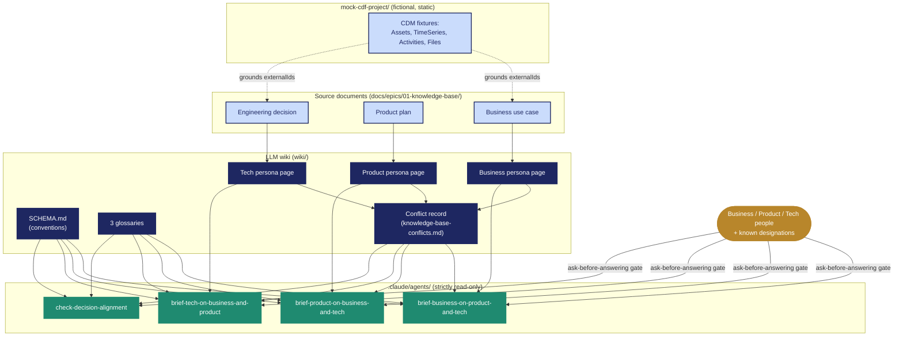

# Architecture — current implementation

What's actually built in this repo today: three source documents become three persona pages
and one conflict record in the wiki; four read-only agents read that wiki to answer people.

**Reading it:** blue = source documents, navy = the wiki, green = the four agents, gold = the
humans asking questions. Every agent reads `SCHEMA.md`, the glossaries, and the conflict
record before answering anything — that's what makes the ask-before-answering gate and the
first-person voice convention consistent across all four.
