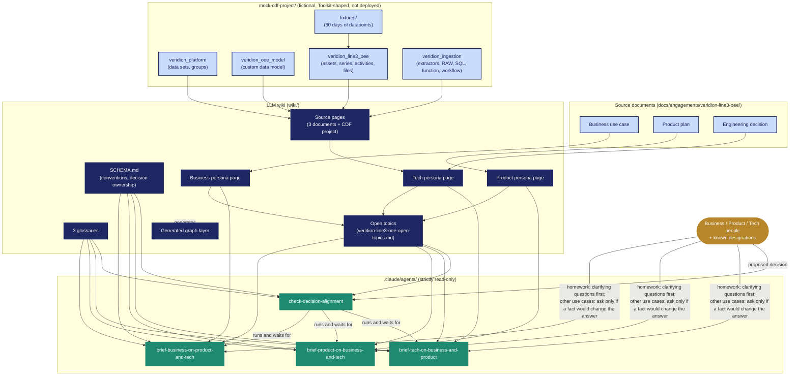

# Architecture — current implementation

**What is being addressed:** teams on a cross-functional engagement (Business, Product, Tech) each
hold part of the picture and meet without knowing what the others know or what to ask them. AdaptPro
builds one knowledge base from the engagement's documents, keeps each persona's claims separate, and
lets each persona query it to understand the others, prepare for meetings and, when a decision is
coming, check whether it is aligned.

The sample engagement is Veridion Line 3 OEE. Line 3 is the polymer line at Calder Valley (Reactor
R-301, then Extruder EX-302), not a software version. Business promised an automatic work order when
its OEE drops; Product and Tech scoped a read-only lookup. The diagram below is how this repo stores
and uses that engagement. It is not the plant system.

## What is built

- **Sources.** Three engagement documents (business use case, PRD, ADR) under
  `docs/engagements/veridion-line3-oee/`, plus a fictional Cognite Data Fusion (CDF) project under
  `mock-cdf-project/`.
- **Mock CDF project.** A Cognite Toolkit project with four modules: `veridion_platform` (data sets,
  access groups), `veridion_oee_model` (a custom data model on top of the Core Data Model),
  `veridion_line3_oee` (about 40 assets, equipment, 21 time series, 11 downtime activities, files) and
  `veridion_ingestion` (extractor and pipeline configs, RAW tables, a SQL transformation, an OEE
  calculation function and an hourly workflow). `fixtures/` generates 30 days of datapoints
  reproducibly, with deliberate data flaws. `cdf build` passes offline; nothing is deployed.
- **LLM wiki** (`wiki/`). Three exclusive persona pages (Business, Product, Tech), source pages for
  each document and for the CDF project, three glossaries, an **open-topics** page, and a generated
  graph layer. `SCHEMA.md` holds the conventions, including who owns which decision (Business owns the
  definition of OEE).
- **Four read-only agents** (`.claude/agents/`): three briefing agents (one per persona) and
  `check-decision-alignment`.
  - **Briefing agents** cover explore beyond your role, homework before a cross-functional meeting,
    and impact. A homework request without the meeting type and goal gets two selectable clarifying
    questions first. The brief is then written as preparation for a brainstorm, and ends with at
    most five questions to ask the other personas, each with a *Why ask* (file and gap) and *A good
    answer settles*. Slack, Teams, Jira, look-ahead and history-plus-now are named in the README but
    not built.
  - **`check-decision-alignment`** runs the three briefing agents on a proposed decision and waits
    for all three before giving one verdict (Aligned, Not aligned, Undetermined). It is the only
    place that uses the "RED" status on the open-topics page.
  - **Every agent queries the wiki for every request**: index first, then a search of the whole wiki, following links and source pages, citing a page per claim, and saying "not in the wiki" when it is absent. They never read the raw `docs/` or `mock-cdf-project/` files.
  - Every agent asks a clarifying question only when a missing fact would change the answer, with
    selectable options and a place to type another answer; homework requests are the exception and
    always ask first when the meeting is unstated.

**Reading it:** blue = source documents and the mock CDF project, navy = the wiki, green = the four
agents, gold = the humans asking questions. The agents search the wiki (index, persona, source, glossary and
open-topics pages) before answering; that is what keeps the question rule
and the first-person voice convention consistent. The agents do not read live CDF: the mock project
reaches them only through the wiki's source pages.

## Not built or not verified

- No deployment of the mock CDF project; extractor configs are not validated against the extractors'
  own schemas, and the SQL transformation has not been executed.
- Datapoint CSVs are not loaded by `cdf build`.
- Slack, Teams, Jira, look-ahead and history-plus-now are not implemented.
- The clarifying-question gate and brainstorm tone were verified on the Tech briefing agent only;
  `check-decision-alignment` has not been re-tested since the OEE ownership rule and the rename.
- The graph layer is generated from the wiki and is not read by the agents.
