# Architecture — for scale (not built)

This is stage 3 of the maturity ladder from the README's Design Rationale: a claim store with
a deterministic check and delta ingest. It is explicitly **not implemented** in this repo — this
diagram documents the target, not the current state, and exists so the gap between "demo" and
"would hold up at scale" is itself an artifact, not just a sentence.

```mermaid
flowchart LR
    subgraph RealSources["Real sources (not this repo's 3 clean docs)"]
        Zoom["Zoom meeting\nsummaries"]
        Slack["Slack threads"]
        Drive["Google Drive\nfiles/folders"]
        Jira["JIRA tickets"]
        Confluence["Confluence docs"]
        KT["Customer KT sessions\n(recordings, PDFs)"]
        Teams["Teams chat"]
        Shared["Shared customer\nfolders"]
        PreSales["Pre-sales\nPPTs/docs"]
    end

    Delta["Delta ingest\n(only the one changed source)"]
    Claims[("Claim store\npromise / scope / constraint,\neach with a source + owner")]
    Check{"Deterministic check\npass/fail on records,\nnot a model grading itself"}
    SignOff["Human sign-off\nnamed, dated, tied to a version"]
    Views["Persona views\n(rendered from records)"]
    Agents["Agents: briefing + decision-check\n(same jobs as today, cheaper reads)"]

    RealSources --> Delta --> Claims
    Claims --> Check
    Check -->|"conflict found"| SignOff
    Check -->|"passes"| Views
    SignOff -->|"accepted version"| Claims
    Claims --> Views --> Agents

    classDef src fill:#CADCFC,stroke:#1E2761,color:#1E2761,stroke-width:2px
    classDef core fill:#1E2761,stroke:#1E2761,color:#ffffff,stroke-width:2px
    classDef check fill:#B8862B,stroke:#B8862B,color:#ffffff,stroke-width:2px
    classDef human fill:#B83A3A,stroke:#B83A3A,color:#ffffff,stroke-width:2px

    class Zoom,Slack,Drive,Jira,Confluence,KT,Teams,Shared,PreSales src
    class Delta,Claims,Views,Agents core
    class Check check
    class SignOff human
```

**What changes vs. today:** ingest only ever processes the one source that changed (not a
full-corpus reread); alignment is decided by a deterministic check against stored records, not
an LLM narrating whether things look aligned; and a sign-off is a dated, named record tied to
one exact version — so a later edit silently voids it instead of leaving a stale green status.
